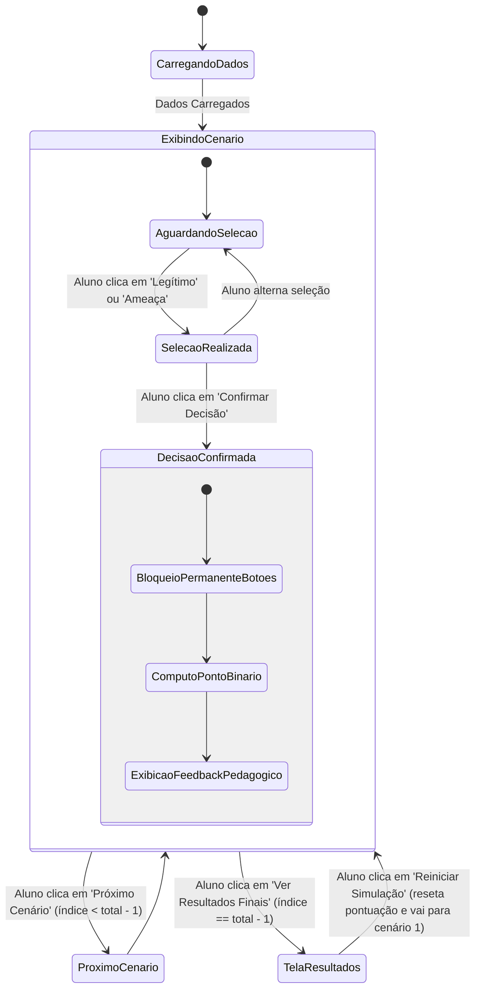

# Data Model Specification: Guardian Social

**Feature**: `001-social-engineering-simulator`  
**Date**: 2026-10-02  
**Status**: Completed  

---

## 1. Entidades Principais

### 1.1 Scenario (Cenário Educativo de Simulação)
Representa um caso simulado de comunicação ou interface digital que o estudante deve analisar.

| Campo | Tipo | Obrigatório | Descrição / Validação |
| :--- | :--- | :---: | :--- |
| `id` | `string` | Sim | Identificador único e estável (ex.: `"scenario-01"`). |
| `order` | `number` | Sim | Posição sequencial na rodada (de 1 a 10). |
| `type` | `string` | Sim | Tipo de interface simulada. Valores válidos: `"email"`, `"sms"`, `"login"`. |
| `title` | `string` | Sim | Título da mensagem ou cabeçalho do contexto (ex.: Assunto do e-mail). |
| `sender` | `SenderInfo` | Sim | Objeto com dados visíveis e inspecionáveis do remetente. |
| `body` | `string` | Sim | Texto ou corpo simulado da mensagem, contendo marcações de pistas. |
| `inspectableElements` | `InspectableElement[]`| Sim | Lista de elementos que podem ser inspecionados pelo aluno. |
| `isThreat` | `boolean` | Sim | Gabarito: `true` se for ameaça de engenharia social, `false` se for legítimo. |
| `threatCategory` | `string` | Sim | Nome da categoria (ex.: `"Phishing Bancário"`, `"Smishing Promoção"`, `"Comunicação Legítima Escolar"`). |
| `iocs` | `string[]` | Sim | Lista de Indicadores de Comprometimento (IoCs) objetivos identificáveis. |
| `emotionalTriggers` | `string[]` | Sim | Gatilhos psicológicos explorados (ex.: `"Urgência"`, `"Medo de Perda"`, `"Curiosidade"`, `"Nenhum (Legítimo)"`). |
| `educationalFeedback`| `EducationalFeedback`| Sim | Análise pedagógica completa exibida após a confirmação da decisão. |

#### Sub-estrutura: SenderInfo
```json
{
  "displayName": "Suporte Técnico Escolar",
  "address": "suporte@portal-aluno.escola.edu.br",
  "securityStatus": "spf_dkim_verified" // ou "domain_mismatch", "unverified"
}
```

#### Sub-estrutura: InspectableElement
```json
{
  "id": "link-01",
  "displayText": "Clique aqui para verificar seus dados",
  "simulatedDestination": "http://portal-aluno.atualizacao-urgente-login.com/auth",
  "isDeceptive": true,
  "explanation": "O domínio de destino difere completamente do domínio oficial da escola."
}
```

#### Sub-estrutura: EducationalFeedback
```json
{
  "correctExplanation": "Excelente! Você identificou que o remetente utiliza um domínio falso com erro sutil de digitação.",
  "incorrectExplanation": "Atenção: este e-mail é uma tentativa de Phishing. O remetente e o link de acesso não pertencem à instituição oficial.",
  "keyRule": "Sempre verifique o domínio real da URL antes de clicar ou fornecer qualquer informação.",
  "categoryTakeaway": "Golpes de e-mail costumam forjar comunicações administrativas para criar falso senso de urgência."
}
```

---

### 1.2 StudentDecision (Decisão do Estudante)
Registra a escolha do estudante para um cenário específico dentro da rodada.

| Campo | Tipo | Obrigatório | Descrição |
| :--- | :--- | :---: | :--- |
| `scenarioId` | `string` | Sim | Referência ao `id` do cenário avaliado. |
| `chosenAction` | `string` | Sim | Opção selecionada pelo estudante: `"legitimate"` ou `"threat"`. |
| `isCorrect` | `boolean` | Sim | `true` se `chosenAction` corresponder a `isThreat` (`"threat"` ↔ `true`, `"legitimate"` ↔ `false`). |
| `timestamp` | `number` | Sim | Momento da confirmação da decisão (milissegundos epoch). |

---

### 1.3 SimulationSession (Sessão de Simulação)
Controla o estado volátil da sessão em execução no navegador.

| Campo | Tipo | Obrigatório | Descrição |
| :--- | :--- | :---: | :--- |
| `currentIndex` | `number` | Sim | Índice do cenário atual em exibição (0 a total - 1). |
| `totalScenarios` | `number` | Sim | Quantidade total de cenários na rodada (normalmente 10). |
| `decisions` | `StudentDecision[]`| Sim | Histórico sequencial das decisões já confirmadas na sessão. |
| `score` | `number` | Sim | Contagem de acertos acumulados (sistema binário: 1 ponto por acerto). |
| `isLocked` | `boolean` | Sim | Trava que impede alterações quando a decisão do cenário atual foi confirmada. |
| `isCompleted` | `boolean` | Sim | `true` quando o estudante conclui o último cenário e avança para a tela final. |

---

### 1.4 PerformanceReport (Relatório Consolidado de Desempenho)
Resultado final gerado e apresentado ao término dos cenários.

| Campo | Tipo | Obrigatório | Descrição |
| :--- | :--- | :---: | :--- |
| `totalAnswered` | `number` | Sim | Total de cenários avaliados. |
| `correctCount` | `number` | Sim | Total de acertos absolutos (ex.: 8). |
| `percentage` | `number` | Sim | Percentual calculado: `(correctCount / totalAnswered) * 100`. |
| `strengths` | `string[]` | Sim | Categorias onde o estudante acertou todos os cenários apresentados. |
| `areasForStudy` | `string[]` | Sim | Categorias com erros cometidos, acompanhadas de dicas de estudo. |
| `levelBadge` | `string` | Sim | Título de proficiência educacional (ex.: `"Guardião Iniciante"`, `"Guardião Alerta"`, `"Mestre da Ciberdefesa"`). |

---

## 2. Ciclo de Vida do Cenário (Máquina de Estados)



---

## 3. Regras de Validação e Integridade

1. **Gabarito Binário**: Todo cenário possui estritamente `isThreat: true` ou `isThreat: false`. Não existem cenários ambíguos sem classificação definida.
2. **Inércia dos Elementos**: Nenhum `simulatedDestination` pode apontar para páginas ativas externas. No código da interface, os links sempre executam `event.preventDefault()`.
3. **Imutabilidade Pós-Confirmação**: Uma vez gravado o objeto `StudentDecision` no array `decisions`, o cenário não aceita novas submissões na mesma rodada.
4. **Cálculo da Taxa de Aproveitamento**: A pontuação percentual é calculada com arredondamento amigável (`Math.round((correctCount / total) * 100)`).
